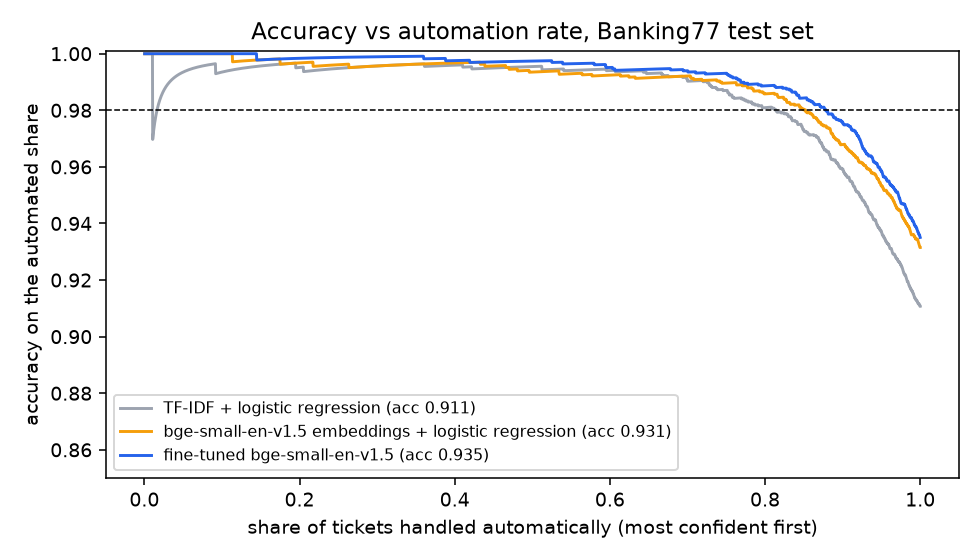

# Support-ticket triage: how many tickets can a model safely handle alone?

Intent classification on [Banking77](https://arxiv.org/abs/2003.04807): 13,083 real customer-support queries in 77 fine-grained intents, such as `card_arrival` vs `card_delivery_estimate` and `pending_transfer` vs `transfer_not_received_by_recipient`. Accuracy alone is the wrong question for a support team. The useful question is: **at an accuracy the business accepts, what share of tickets can be routed without a human, and how much does each model cost to run?**

So this compares three model families and adds the two pieces a deployment needs: **calibrated confidence** (temperature scaling) and **a confidence threshold picked on validation data** that sends uncertain tickets to a person.

## Results (official 3,080-query test set)

Training used the train split minus a stratified 10% validation set. Temperature and thresholds were fit on validation, then frozen.

| Model | Test accuracy | Macro-F1 | ECE raw → calibrated | **Auto-handled at a 98% target** (accuracy achieved) | ms / ticket | Train time |
|---|---|---|---|---|---|---|
| TF-IDF (word + char n-grams) + logistic regression | 0.911 | 0.911 | 0.064 → 0.009 | 78.3% (98.3%) | **0.03** (CPU) | 8 s |
| bge-small embeddings + logistic regression | 0.931 | 0.931 | 0.108 → 0.013 | 78.6% (98.7%) | 0.35 (CPU) | 5 s + encoding |
| **Fine-tuned bge-small (33M params)** | **0.935** | **0.935** | 0.032 → 0.014 | **85.5% (98.4%)** | 0.94 (M4 Pro GPU) | 171 s |



At 95% and 99% targets the fine-tuned model automates 94.5% and 73.5% of tickets, achieving 96.1% and 99.3% accuracy. All nine thresholds (3 models × 3 targets), chosen on validation data, met their target on test. The closest call was embeddings at the 95% target, which achieved 95.4%. Full numbers are in [`results/results.json`](results/results.json).

For reference, the Banking77 paper reports about 93.6% for BERT-base (110M parameters). A fine-tuned 33M-parameter model matches it here.

## What I take from this

1. **The baseline is closer than the hype suggests.** TF-IDF + logistic regression gets 91.1%, trains in 8 seconds and classifies a ticket in 0.03 ms on a CPU. The fine-tuned transformer adds 2.4 points of accuracy. **What the transformer really buys is automation:** at the same 98% accuracy bar it handles 85.5% of tickets instead of 78.3%, about 220 fewer tickets per 3,000 for a human.
2. **Calibration is cheap and necessary.** Raw confidences were off by 3–11 points (ECE). One fitted temperature per model cut that to about 1 point. Without it, a "90% confident" ticket is not right 90% of the time, and a threshold means nothing.
3. **Remaining errors are mostly label ambiguity, not model failure.** The most common confusions are `pending_transfer` → `transfer_not_received_by_recipient` (6), `card_delivery_estimate` ↔ `card_arrival` (4 + 3) and `transfer_timing` ↔ `balance_not_updated_after_bank_transfer` (3 + 3). A human would hesitate on many of those queries too. That argues for merging intents or adding a clarifying question, not for a bigger model.

## Two fine-tuning runs that failed, kept on purpose

| Run | Val acc | Test acc | What went wrong |
|---|---|---|---|
| MiniLM-L12 raw checkpoint, lr 8e-5, 6 epochs | not recorded | 0.687 | Training loss was still 1.6 after 6 epochs: underfit |
| bge-small, one lr (5e-5) for everything | 0.858 | 0.839 | Loss 1.27 after 5 epochs |
| **bge-small, head lr 2e-3, encoder lr 5e-5** | **0.928** | **0.935** | Loss 0.03 |

The fix was not a bigger model. The pooler and classification head start from random weights, and at the encoder's small learning rate they barely move. Giving them their own learning rate took the first epoch's loss from 3.86 to 1.43. I chose the configuration by validation accuracy. The test column is shown for transparency.

## Serving

```bash
uvicorn triage.api:app        # serves models/tfidf.joblib, written by the experiment
curl -s localhost:8000/classify -H 'content-type: application/json' -d '{"text":"my new card still has not shown up"}'
# {"intent":"card_arrival","confidence":0.93,"route":"auto","alternatives":[...]}
```

The API serves the TF-IDF model on purpose: no GPU, no model download, sub-millisecond latency, and the same calibrated route/escalate contract. Swapping in the fine-tuned model is a deployment decision about whether 7 more points of automation are worth a GPU, and the table above is what that decision needs.

## Run it

```bash
uv venv && uv pip install -e '.[neural,api,dev]'
mkdir -p data && for s in train test; do curl -sSfL -o data/$s.csv https://raw.githubusercontent.com/PolyAI-LDN/task-specific-datasets/master/banking_data/$s.csv; done
python -m triage.experiment          # ~4 min on an M4 Pro
pytest
```

## Limitations

- Single seed per model. The 0.4-point gap between embeddings + LR and fine-tuning is within what a seed change could move. The automation-rate gap (78.6% → 85.5%) is larger.
- Banking77 queries are short single sentences. Real tickets are longer, multi-intent and come with history.
- An LLM zero-shot or few-shot baseline is not included (no API key in the build environment). It would be the natural fourth row, especially for intents with few examples.
